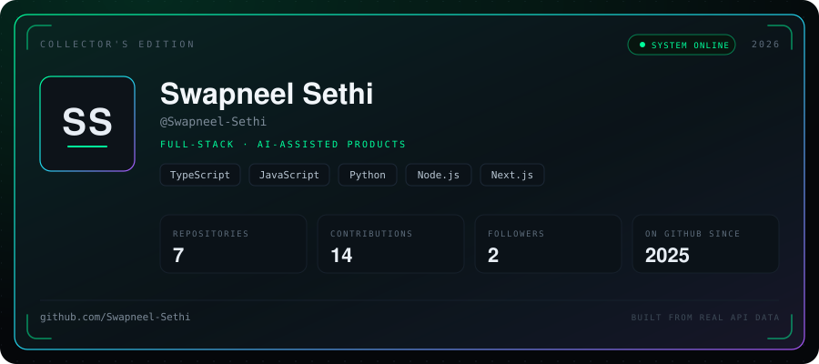

<div align="center">

# Swapneel Sethi

`FULL-STACK DEVELOPER` · `AI-ASSISTED PRODUCTS` · `SHIPS WORKING SOFTWARE`

I take hackathon briefs and real-world friction and turn them into deployed products — full-stack apps where AI does something load-bearing instead of decorative.

<br/>

[](https://github.com/Swapneel-Sethi)
[](https://github.com/Swapneel-Sethi?tab=repositories)
[](#projects)
[](https://github.com/Swapneel-Sethi)

</div>

<br/>

<div align="center">



</div>

<br/>

## `01` — STATUS

```text
┌────────────────────────────────────────────────────────────┐
│  ● SYSTEM ONLINE                                           │
│                                                            │
│  CURRENTLY BUILDING                                        │
│  > CareMesh — elder-first care coordination platform       │
│                                                            │
│  FOCUS                                                     │
│  > full-stack products · applied AI · accessibility        │
│                                                            │
│  MODE                                                      │
│  > building · learning · shipping                          │
└────────────────────────────────────────────────────────────┘
```

---

## `02` — STACK

Only what actually appears in my repositories.

| Layer | What I use it for |
| :--- | :--- |
| **Languages** | TypeScript · JavaScript · Python · HTML · CSS |
| **Frontend** | React · Next.js · Vite · Tailwind CSS · Chart.js · Recharts · Three.js / react-three-fiber · deck.gl · D3 |
| **Backend** | Node.js · Next.js route handlers · zero-dependency Node services · Zod validation |
| **AI / Data** | Google Vertex AI (Gemini) · PDF parsing (pdf-parse, unpdf) · evidence graphs · graph & force layouts (vis-network, 3d-force-graph) |
| **Data & auth** | Supabase · Firebase (client + admin) |
| **DevOps** | Docker · Google Cloud Run · Cloud Build · Vercel · GitHub Actions |

---

## `03` — PROJECTS

<br/>

### 🧩 CareMesh — elder-first care coordination

A care circle for the people who actually coordinate care: medication scheduling, adherence tracking, appointments, missed-dose escalation, and an AI-generated daily care brief. Role-based access for elder, family, and caregiver, with an audit timeline behind every action.

**Built to be trusted:** zero runtime dependencies, five `node --test` suites, accessibility-first UI (keyboard focus, reduced motion, large targets), Cloud Run container with a health endpoint, and a Gemini adapter that falls back deterministically when the model is unavailable.

`JavaScript` `Node.js` `Vertex AI` `Docker` `Cloud Run` `Resend`

[Repository](https://github.com/Swapneel-Sethi/caremesh) · [Live demo](https://caremesh-one.vercel.app)

<br/>

### 🔍 EVIDENT — evidence-grounded recruitment intelligence

Recruiting has an evidence problem, not a reading problem. EVIDENT builds a candidate evidence graph per workspace: requirements extracted from the job description, claims extracted from resumes, and every link carrying its source, snippet, status, and the interview question that would resolve it. Interview answers update the graph. No scores, no rankings, no hire/reject.

`TypeScript` `Next.js` `React` `Supabase` `Zod` `PDF parsing`

[Repository](https://github.com/Swapneel-Sethi/evident)

<br/>

### 🕸️ Mule Detection — network analysis for fraudulent accounts

A Next.js investigation console that renders account networks as an interactive force graph, with Plotly and Recharts layers for the underlying signals, backed by Firebase. Built as a team project.

`Next.js` `React` `Three.js` `3d-force-graph` `Plotly` `Firebase`

[Repository](https://github.com/Swapneel-Sethi/mule-detection) · [Live demo](https://mule-detection.vercel.app)

<br/>

### 📝 Plagiarism Checker — originality engine

A checker that runs offline by default and against the live web when you give it a backend: a shingle-containment engine scores local corpus matches, while a Node service searches for distinctive sentences, fetches the top results, and feeds them through the same logic so web matches land in the same report. Monochrome gallery UI, no build step.

`JavaScript` `Node.js` `SerpAPI` `HTML` `CSS`

[Repository](https://github.com/Swapneel-Sethi/plagiarism-checker) · [Live demo](https://plagiarism-checker-teal.vercel.app)

<br/>

### 🚢 FreightPulse — freight forecasting dashboard

A SIH 2026 build: forecasting, demurrage modelling, scenario optimization, AIS monitoring, model training, and a live war room for freight operations.

`JavaScript` `Vite` `Chart.js` `HTML` `CSS`

[Repository](https://github.com/Swapneel-Sethi/freightpulse-frontend)

<br/>

### 🌐 Freight Oracle — logistics command dashboard

The TypeScript counterpart: a command dashboard, crisis war room, demurrage simulator, fleet ballaster, and scenario optimizer, drawn over real India coastline GeoJSON with deck.gl and a custom Three.js renderer.

`TypeScript` `React` `deck.gl` `Three.js` `TanStack Query` `Recharts`

[Repository](https://github.com/Swapneel-Sethi/freight-oracle-frontend)

---

## `04` — ACTIVITY

**14 contributions in the last 12 months** · 7 public repositories · on GitHub since July 2025.

Most of my commit history lives in projects authored under a local git identity, so the public contribution graph undercounts the real work. The repositories above are the honest record.

[→ Full contribution graph](https://github.com/Swapneel-Sethi?tab=overview&from=2026-01-01&to=2026-12-31)

---

## `05` — CURRENTLY BUILDING

```text
┌────────────────────────────────────────────────────────────┐
│  CURRENTLY BUILDING                                        │
│                                                            │
│  → CareMesh      care coordination + AI care briefs        │
│  → EVIDENT       evidence graphs for hiring teams          │
│  → Freight stack forecasting + logistics war rooms         │
└────────────────────────────────────────────────────────────┘
```

---

## `06` — TERMINAL

```text
$ whoami

swapneel-sethi
full-stack developer
builds AI-assisted products
ships them deployed

$ current_status

reading the brief
finding the real problem
building the smallest thing that solves it
deploying it

$ principle

working software over slides
```

---

<div align="center">

### Have a problem worth building for?

[](https://github.com/Swapneel-Sethi)
[](https://github.com/Swapneel-Sethi?tab=repositories)

<sub>`─────────────────────────────────────────────────────────────`</sub>

<sub>Every number on this page comes from the GitHub API. Nothing here is a placeholder.</sub>

</div>
