<!-- Cards are generated by scripts/render_readme_cards.py and refreshed daily by
     .github/workflows/update-profile-art.yml. Keep this block free of blank lines
     and keep each image tag on its own line with no spaces between adjacent images. -->

<strong>Swapneel Sethi</strong>
 
<em>Full-stack developer — I build AI products end to end: data, model, interface, and put them online.</em>

<a href="https://github.com/Swapneel-Sethi">github</a> &nbsp;/&nbsp;
<a href="https://evident-olive.vercel.app">evident</a> &nbsp;/&nbsp;
<a href="https://holdout-taupe-iota.vercel.app">holdout</a> &nbsp;/&nbsp;
<a href="https://airloom-brown.vercel.app">airloom</a> &nbsp;/&nbsp;
<a href="https://caremesh-one.vercel.app">caremesh</a> &nbsp;/&nbsp;
<a href="https://mule-detection.vercel.app">muleguard</a> &nbsp;/&nbsp;
<a href="https://pdfhater.vercel.app">pdf-hater</a>

<!-- Profile cards are machine-generated art. Below is the human-written
     summary — keep it short, truthful and updated when a repo graduates. -->

What I build
---

**PRODUCTS** — 04 live products
EVIDENT · HOLDOUT · AIRLOOM · CAREMESH — evidence review, dataset audits, air-quality planning and care coordination, each deployed and linkable from this profile.

**AI / DATA** — 59 benchmark datasets
Holdout’s leakage benchmark, MuleGuard’s synthetic fraud graph and EVIDENT’s structured extraction are all checked against real artifacts.

**SYSTEMS** — 32/32 tests, two suites
CareMesh (19/19) and Airloom (13/13) run real suites. Signed sessions, provider failover and rule-based fallbacks are implemented, not advertised.

Selected work
---

**01 · EVIDENT** — [evident-olive.vercel.app](https://evident-olive.vercel.app) · [repo](https://github.com/Swapneel-Sethi/evident)
Hiring evidence, not hiring scores. Claims, sources and interview answers flow through six review states; the human decides.
Strongest signal: three AI providers with automatic failover; Zod-validated orchestration before persistence.
**3-PROVIDER FAILOVER** — live.

**02 · HOLDOUT** — [holdout-taupe-iota.vercel.app](https://holdout-taupe-iota.vercel.app) · [repo](https://github.com/Swapneel-Sethi/holdout)
Audit the dataset before trusting the score. Holdout finds leakage, quantifies how much a validation score survives once suspicious columns are removed, verifies its own findings and returns Ship, Review or Block.
Strongest signal: six-stage audit, eight deterministic detectors, second-path verification. No LLM verdict.
**59 DATASETS · F1 0.869** — leak recall 0.908, clean pass 0.833, verified claims 100%.

**03 · AIRLOOM** — [airloom-brown.vercel.app](https://airloom-brown.vercel.app) · [repo](https://github.com/Swapneel-Sethi/airloom)
An air-quality forecast turned into a day plan: when to move, commute, ventilate and what to change. Every recommendation states its reason and its data source.
Strongest signal: deterministic planning core; Gemini explains the plan but never invents a reading.
**13/13 SELF-CHECKS** — live.

**04 · CAREMESH** — [caremesh-one.vercel.app](https://caremesh-one.vercel.app) · [repo](https://github.com/Swapneel-Sethi/caremesh)
Care coordination where the elder stays in control — medications, appointments, reminders and a trusted care circle.
Strongest signal: scrypt passcodes, HMAC-signed sessions, server-side authorization on every protected write.
**19/19 TESTS** — live.

Proof, not claims
---

Every metric above is verified against repository artifacts:

- **Holdout** — 59 datasets, F1 0.869, leak recall 0.908, clean pass rate 0.833, verified claims 100%. (`npm test` and `npm run benchmark` reproduce it.)
- **Airloom** — 13/13 self-checks pass (`npm test`).
- **CareMesh** — 19/19 tests pass (`npm test`), covering validation, authorization, reminders, security and end-to-end login.
- **PDF-Hater** — 25 client-side PDF tools, fully in-browser, live at pdfhater.vercel.app.

No expert, elite, visionary or world-class language. These are implementation facts from the repos.

Currently building
---

- **MuleGuard** — DEMO LIVE. Mule-account detection cockpit on a transaction graph: 87,613 engineered accounts, XGBoost scoring, graph features and behavioural states. Trained on synthetic data; no production claim.
- **AERASCAN** — SIMULATED. A 21-stage reconstruction UX where every value carries provenance; labelled simulated throughout.
- **The Honest Planner** — 52 tests pass. Investing education and planning. Deployment is currently access-protected.

Tech stack
---

- **Frontend** — React, Next.js, TypeScript, Tailwind, Three.js, Recharts
- **Backend** — Node.js, FastAPI, REST APIs, Supabase, Firestore, Zod
- **AI / Data** — Gemini, Groq, Mistral, XGBoost, scikit-learn, pandas
- **Infrastructure** — Vercel, Cloud Run, Docker, GitHub Actions, Resend
- **Systems** — Auth + sessions, audit trails, provider failover, rule fallbacks

Links
---

- **GitHub** — github.com/Swapneel-Sethi
- **EVIDENT** — evident-olive.vercel.app
- **HOLDOUT** — holdout-taupe-iota.vercel.app
- **AIRLOOM** — airloom-brown.vercel.app
- **CAREMESH** — caremesh-one.vercel.app
- **MuleGuard** — mule-detection.vercel.app
- **PDF-Hater** — pdfhater.vercel.app
