# Swapneel Sethi

Full-stack developer — Full-stack developer — I build AI products end to end: data, model, interface, and put them online.

## What I build

**PRODUCTS** — 04 live products
EVIDENT · HOLDOUT · AIRLOOM · CAREMESH — Evidence review, dataset audits, air-quality planning and care coordination.

**AI / DATA** — 59 benchmark datasets
HOLDOUT · MULEGUARD · EVIDENT — Leakage detection, fraud graphs and structured extraction, checked against artifacts.

**SYSTEMS** — 32/32 tests, two suites
CAREMESH · AIRLOOM — Signed sessions, server-side authorization, provider failover, audit trails.

Selected work
---

**01 · HOLDOUT [PINNED]** — [holdout-taupe-iota.vercel.app](https://holdout-taupe-iota.vercel.app) · [repo](https://github.com/Swapneel-Sethi/holdout)
Audit the dataset before trusting the score. Holdout finds leakage, quantifies how much a validation score survives once suspicious columns are removed, verifies its own findings and returns Ship, Review or Block.
Strongest signal: Six-stage audit, eight deterministic detectors, second-path verification. No LLM verdict.
**59 DATASETS · F1 0.869** — live.

**02 · EVIDENT [PINNED]** — [evident-olive.vercel.app](https://evident-olive.vercel.app) · [repo](https://github.com/Swapneel-Sethi/evident)
Hiring evidence, not hiring scores. Claims, sources and interview answers flow through six review states; the human decides.
Strongest signal: Three AI providers with automatic failover. Zod-validated orchestration before persistence.
**3-PROVIDER FAILOVER** — live.

**03 · AIRLOOM** — [airloom-brown.vercel.app](https://airloom-brown.vercel.app) · [repo](https://github.com/Swapneel-Sethi/airloom)
An air-quality forecast turned into a day plan: when to move, commute, ventilate and what to change. Every recommendation states its reason and its data source.
Strongest signal: Deterministic planning core. Gemini explains the plan but never invents a reading.
**13/13 SELF-CHECKS** — live.

**04 · CAREMESH** — [caremesh-one.vercel.app](https://caremesh-one.vercel.app) · [repo](https://github.com/Swapneel-Sethi/caremesh)
Care coordination where the elder stays in control — medications, appointments, reminders and a trusted care circle.
Strongest signal: Scrypt passcodes, HMAC-signed sessions, server-side authorization on every protected write.
**19/19 TESTS** — live.

Pinned projects are flagship work protected from automatic removal.
Unpinned projects compete for the remaining Selected Work slots.

Proof, not claims
---

Every metric below is verified against repository artifacts:
- **HOLDOUT** — 59 datasets in the leakage benchmark.
- **HOLDOUT** — 0.908 leak recall on that benchmark.
- **HOLDOUT** — 0.869 F1 on the leakage benchmark.
- **HOLDOUT** — 0.833 clean pass rate on clean controls.
- **AIRLOOM** — 13/13 Airloom self-checks pass.
- **CAREMESH** — 19/19 CareMesh tests pass.
- **PDF-HATER** — 25 client-side PDF tools.

No expert, elite, visionary or world-class language. These are implementation facts from the repos.

Currently building
---
- **MuleGuard** — DEMO LIVE. Fraud graph with 87,613 engineered accounts. Next: evaluation beyond synthetic labels.
- **AERASCAN** — SIMULATED. A 21-stage reconstruction UX where every value carries provenance. Next: a real CV backend.
- **The Honest Planner** — 52 TESTS. Investing education and planning. Deployment is currently access-protected.

Tech stack
---
- **FRONTEND** — React, Next.js, TypeScript, Tailwind, Three.js, Recharts
- **BACKEND** — Node.js, FastAPI, REST APIs, Supabase, Firestore, Zod
- **AI / DATA** — Gemini, Groq, Mistral, XGBoost, scikit-learn, pandas
- **INFRASTRUCTURE** — Vercel, Cloud Run, Docker, GitHub Actions, Resend
- **SYSTEMS** — Auth + sessions, audit trails, provider failover, rule fallbacks

Links
---
- **GitHub** — github.com/Swapneel-Sethi
- **Live work** — [github](https://github.com/Swapneel-Sethi) &nbsp;/&nbsp; [evident](https://evident-olive.vercel.app) &nbsp;/&nbsp; [holdout](https://holdout-taupe-iota.vercel.app) &nbsp;/&nbsp; [airloom](https://airloom-brown.vercel.app) &nbsp;/&nbsp; [caremesh](https://caremesh-one.vercel.app) &nbsp;/&nbsp; [muleguard](https://mule-detection.vercel.app) &nbsp;/&nbsp; [pdf-hater](https://pdfhater.vercel.app)
